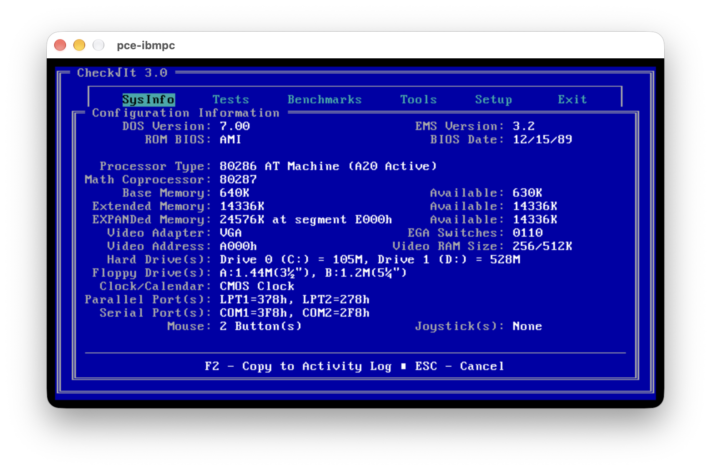
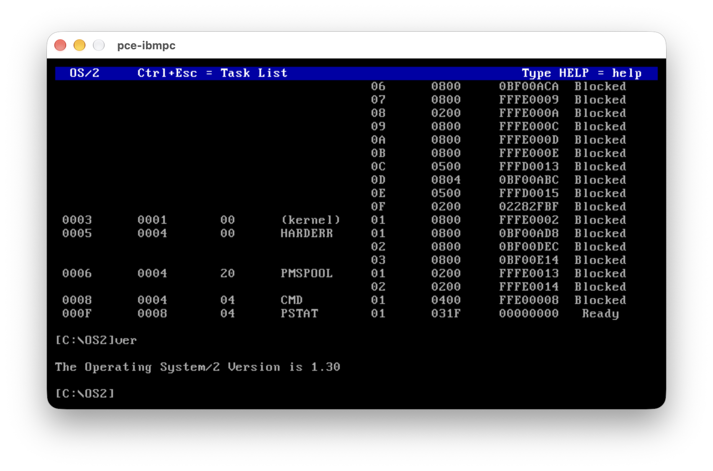

# PCE-286

PCE-286 extends [PCE](http://www.hampa.ch/pce/), Hampa Hug’s excellent emulator environment.
All credit for PCE goes to Hampa.

## Enhancements to Hampa's PCE

### Intel 80286 and IBM PC/AT

- Added protected-mode execution, descriptor checks, gates, privilege transitions and task switching.
- Added IBM 5170 hardware: cascaded interrupt controllers, 8042 keyboard controller, A20 gate, CMOS RTC and WD1003 fixed-disk controller.
- Verified native DOS boot with IBM and AMI AT BIOSes. Installed and booted OS/2 1.3.

| IBM PC/AT | OS/2 |
|---|---|
|  |  |

### NEC V20/V30

- Added NEC native instruction support and transitions between native and 8080 modes.
- Reused the 8080 core for emulation-mode execution.
- Verified a CP/M-80 assembler and its generated program under VCPM on CP/M-86 (V20).

### Intel 8087 and 80287

- 8087 on PC/XT, 80287 on AT. Supports 80-bit arithmetic, conversions and numeric exceptions.
- CheckIt and 87TEST pass on the emulated 80287. Timing and transcendental results remain approximate. [Configuration and limits](doc/numeric-coprocessors.md)

### EEMS banked memory on XT and AT

- Added a 2 MiB ISA board with 24 bankable 16 KiB windows spanning 256–640 KiB.
- **Concurrent DOS XM 6.21:** `eems {}` with Internal EEMS enabled. Four concurrent tasks verified separate 48 KiB patterns at the same address on XT and AT.
- **MS-DOS 6.22:** `eems { dos_frame = 1 }` with `PCEEEMM.SYS`. Verified all 104 allocatable pages (1,664 KiB) on XT and AT.
- Documented [board and driver configuration](src/arch/ibmpc/pce-ibmpc.cfg.in) alongside the existing software EMS option.

### Idle CPU usage

PCE skips redundant clock checks while a native CPU is halted. For single-task real-mode DOS, run `PCEIDLE.COM` from AUTOEXEC.BAT to halt during DOS idle calls and wake on interrupts.

| Idle guest, speed 24, null display/audio | Host CPU (% of one core) |
|---|---:|
| MS-DOS 6.22 prompt, XT | 28.6% |
| MS-DOS 6.22 prompt, XT with PCEIDLE | 6.1% |
| Concurrent DOS XM 6.21, XT, four idle consoles | 29.0% with `IDLE=ON`, 32.2% with `IDLE=OFF` |
| OS/2 1.3 desktop, AT | 31.4% |

Single-host samples: 10 seconds for DOS and CDOS, 15 seconds for OS/2. Guest clock advancement and keyboard response verified on DOS and CDOS. [Measurement procedure](doc/host-debugging.md)

## Documentation

[Documentation index](doc/index.md) · [IBM XT](doc/ibmxt-config.md) · [IBM AT](doc/ibmat-config.md) · [Memory](doc/ibmpc-memory.md) · [Disks](doc/disk-creation.md) · [Testing](doc/testing.md)

## Install

To install do:

```
./autogen.sh
./configure
make
make install
```

The most important options for configure are:

```
--prefix=path
Set the installation prefix. The default is /usr/local.

--with-x11[=path]
Build the X11 based terminal.

--with-sdl
Build the SDL based terminal.
```
