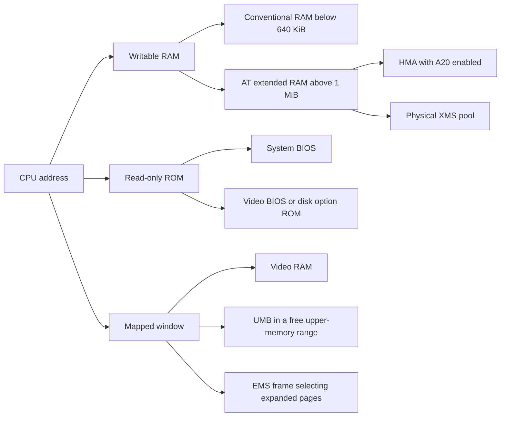
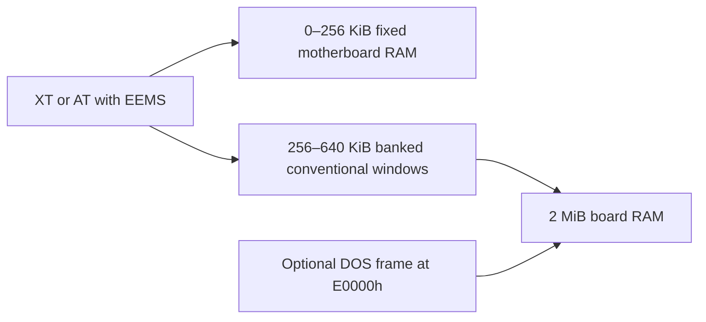

# IBM PC memory quick reference

Choose a guest profile first. Then fit its ROMs, upper-memory blocks and page frame into the address map. In PCE, `address` is a **byte address**. `segment` and `umb_segm` are **paragraph addresses**: segment `0xE000` starts at byte `0xE0000`.

## RAM, ROM and mapped windows





## Choose a profile

| Guest / purpose | Machine configuration | Guest memory manager |
|---|---|---|
| XT DOS, conventional memory only | 640 KiB RAM at 0 | None required |
| XT or AT DOS, software EMS | 640 KiB at 0; add `ems { size = 16M segment = 0xe000 }` | `DEVICE=C:\PCE\PCEEMM.SYS` |
| AT DOS, physical XMS + HMA + UMB | 640 KiB at 0; add extended RAM and the `xms` block below | Load `PCEHIMEM.SYS` as the sole XMS manager. Software EMS can coexist in a separate frame. |
| AT, OS/2 or native guest memory manager | 640 KiB at 0; contiguous RAM from 1 MiB | Let the guest manage physical RAM. Omit PCE memory helpers. |
| XT/AT, CDOS XM native EEMS | **256 KiB** at 0; add `eems {}` | Enable **Internal EEMS** in CDOS SETUP and save. Omit external EMM and the software `ems` pool. |
| XT/AT DOS, EEMS board via INT 67h | **256 KiB** at 0; add `eems { dos_frame = 1 }`; reserve E0000h–EFFFFh | `DEVICE=C:\PCE\PCEEEMM.SYS` (three Es after PC). Omit `ems {}`. |

## Physical address map

Example with VGA, an 8 KiB PCEX option ROM, UMBs and an EMS frame. End addresses are inclusive. Actual ROM sizes and addresses depend on the machine.

| Byte range (hex) | Size | Owner |
|---|---:|---|
| 00000–3FFFF | 256 KiB | Low conventional RAM, including interrupt vectors and BIOS data |
| 40000–9FFFF | 384 KiB | Rest of conventional RAM. With EEMS, board-backed windows occupy this range instead. |
| A0000–BFFFF | 128 KiB | Video aperture, including color text memory at B8000 |
| C0000–C5FFF | 24 KiB | Example VGA BIOS |
| C6000–C7FFF | 8 KiB | Gap in this example; check the actual video ROM length |
| C8000–C9FFF | 8 KiB | Example PCEX ROM. A native XT disk controller ROM can require a larger reservation here. |
| CA000–DFFFF | 88 KiB | Example contiguous UMB, if the entire range is free |
| E0000–EFFFF | 64 KiB | Optional DOS EMS page frame: four 16 KiB windows |
| F0000–FFFFF | 64 KiB | System BIOS region |
| 100000–10FFEF | 65,520 bytes | HMA, within the first 64 KiB of AT extended RAM |
| 110000 upward | Configured | Physical XMS pool in the example below |
| FE0000–FFFFFF | 128 KiB | Reserved high ROM region on the emulated AT |

## What each facility does

| Facility | Engineering rule |
|---|---|
| RAM | A `ram` block installs writable physical memory. AT CMOS counts contiguous writable extended RAM starting at 100000h; a gap ends the count. |
| ROM | A `rom` block reserves read-only space. Specify its file in the block or populate it with a matching `load` section. Reserve the whole decoded window, even if the file is smaller. |
| XMS | A DOS allocation interface. On a 286, PCEHIMEM can allocate from a configured physical extended-RAM block. On an ordinary XT, host-backed XMS is an emulator service; it does not give an 8088 a 286 address bus. |
| HMA / A20 | With A20 enabled, real-mode addresses from FFFF:0010 through FFFF:FFFF reach the HMA. On DOS versions supporting it, `DOS=HIGH` requests this area. |
| UMB | Writable conventional-style memory between 640 KiB and 1 MiB. On supported DOS versions, `DOS=UMB` links available blocks; `DEVICEHIGH` and `LOADHIGH` can use them. |
| EMS | INT 67h maps logical 16 KiB pages into a fixed frame. A 16 MiB pool still needs only a 64 KiB frame. Frame size and pool size measure different things. |
| EEMS | One 2 MiB emulated ISA board. CDOS can bank application memory below 640 KiB during task switches. In the DOS driver profile, 384 KiB backs conventional RAM and 1,664 KiB is allocatable through INT 67h. |

## Example: AT DOS with XMS, HMA, UMB and software EMS

```ini
ram { address = 0        size = 640K }
ram { address = 0x100000 size = 4M }
xms { xms_size = 0 hma = 1 umb_segm = 0xca00 umb_size = 88K }
ems { segment = 0xe000 size = 16M }
```

With this layout CMOS reports **4096 KiB extended**. The helper reserves 64 KiB for the HMA and exposes **4032 KiB of physical XMS**. The 16 MiB EMS pool is separate. Here `xms_size = 0` still permits physical XMS because the configured RAM supplies the pool.

```dos
DEVICE=C:\PCE\PCEHIMEM.SYS
DOS=HIGH,UMB
DEVICE=C:\PCE\PCEEMM.SYS
```

## Verify a configuration

- **Startup log:** check RAM addresses and sizes, ROM loads, CMOS totals and active EMS/XMS/EEMS windows. An overlap diagnostic identifies the conflicting ranges.
- **DOS:** use `MEM /C` where supported to inspect driver placement. Use an EMS allocation/map/readback test to verify usable pages.
- **CDOS XM:** check the boot line `EEMS Paged Memory (Kb) : 2048` and `BANK`. `LIMSIZE` reports a per-window application setting; it does not measure native bank usage.

[XT configuration](ibmxt-config.md) · [AT configuration](ibmat-config.md) · [Configuration template](../src/arch/ibmpc/pce-ibmpc.cfg.in)

## Implementation limits

- On a 286, the XMS helper selects the lowest eligible extended RAM block below FE0000h. Separate blocks are not combined into one allocation pool. A contiguous block starting at 100000h shares its first 64 KiB with the HMA.
- Without eligible physical extended RAM, the legacy host-backed XMS helper can provide storage. Its lock address is unsuitable for protected-mode physical access.
- A 5160 with a 286 accelerator retains the XT motherboard devices. CPU selection alone does not install AT CMOS or the 8042 controller.
- At startup, a conflicting software EMS frame disables that frame. A conflicting UMB disables UMB service while leaving XMS available. Software EMS is configured before the UMB. Runtime mapping changes require separate validation.

The DOS board driver provides basic LIM services 40h–48h and 4Bh–4Dh. AST-specific enhanced calls and multitasker context services are outside its current interface.
